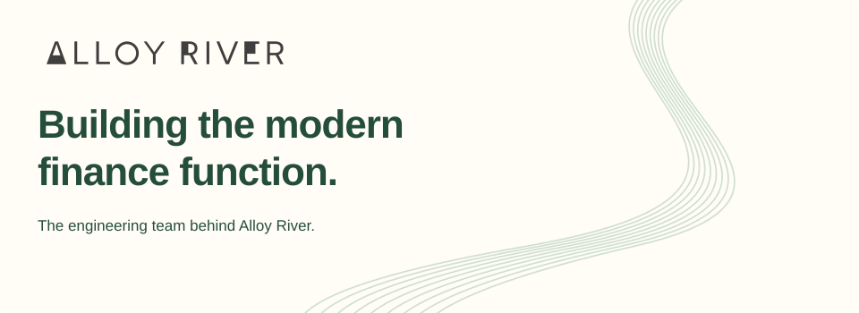
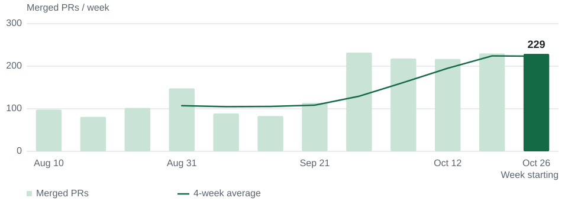

<!-- Generated from content.json and momentum.json. Edit those files, then run scripts/render_profile.py. -->
<picture>
  <source media="(prefers-color-scheme: dark)" srcset="./assets/banner-dark.svg">
  
</picture>

We build AI-native software that helps finance and accounting teams automate the busywork and focus on their clients.

[Website](<https://www.alloyriver.com/>) &nbsp; · &nbsp; [Careers](<https://www.alloyriver.com/careers>) &nbsp; · &nbsp; [LinkedIn](<https://www.linkedin.com/company/alloyriver>) &nbsp; · &nbsp; [Say hello](<mailto:hi@alloyriver.com>)

## Built every week.

Twelve weeks of engineering momentum. **Aug 10, 2026 – Nov 1, 2026.**

<picture>
  <source media="(max-width: 520px) and (prefers-color-scheme: dark)" srcset="./assets/momentum-dark-compact.svg">
  <source media="(max-width: 520px)" srcset="./assets/momentum-light-compact.svg">
  <source media="(prefers-color-scheme: dark)" srcset="./assets/momentum-dark.svg">
  
</picture>

| PRs merged in 12 weeks | PRs merged last week | Four-week average |
| :--- | :--- | :--- |
| **1,841** | **229** | **224** |

fms + fms-frontend + integrations · Complete weeks, Toronto time · Includes all PR authors · Snapshot captured Nov 3, 2026

---

Good work compounds. [Build with us](<https://www.alloyriver.com/careers>).
