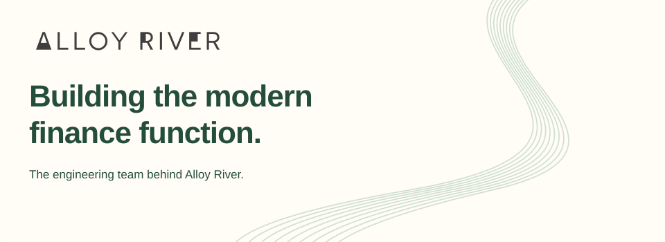
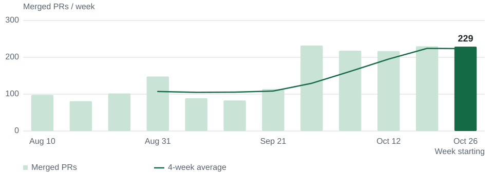

<!-- Generated from content.json and momentum.json. Edit those files, then run scripts/render_profile.py. -->
<picture>
  <source media="(prefers-color-scheme: dark)" srcset="./assets/banner-dark.svg">
  
</picture>

$description

$links

## Built every week.

Twelve weeks of engineering momentum. **$range.**

<picture>
  <source media="(max-width: 520px) and (prefers-color-scheme: dark)" srcset="./assets/momentum-dark-compact.svg">
  <source media="(max-width: 520px)" srcset="./assets/momentum-light-compact.svg">
  <source media="(prefers-color-scheme: dark)" srcset="./assets/momentum-dark.svg">
  
</picture>

| PRs merged in 12 weeks | PRs merged last week | Four-week average |
| :--- | :--- | :--- |
$stats

fms + fms-frontend + integrations · Complete weeks, Toronto time · Includes all PR authors · Snapshot captured $as_of

---

$footer
